<p align="center">
  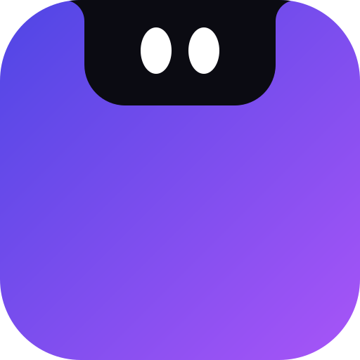
</p>

<h1 align="center">Monday Notch</h1>

<p align="center">
  A small, living notch at the top of your Windows screen.<br>
  Music with synced lyrics, quick controls, a focus timer, to-dos and notes, one hover away.
</p>

<p align="center">
  <a href="https://github.com/ryanmhildan/monday-notch/releases/latest"></a>
  
  
  <a href="LICENSE"></a>
</p>

<p align="center">
  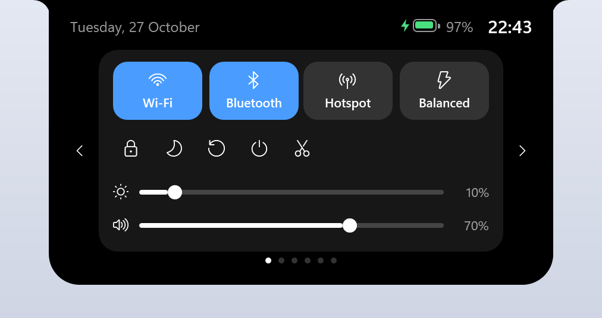
</p>

## Download

1. Go to **[Releases](https://github.com/ryanmhildan/monday-notch/releases/latest)** and download `MondayNotch.exe`.
2. Run it. There is nothing to install, because the .NET runtime is built in.

The app isn't code-signed yet, so Windows SmartScreen may say *"Windows protected your PC"*. Click **More info**, then **Run anyway**.

Hover the notch to open it and move away to close it. Right-click the tray icon (next to the clock) for **Settings** and **Exit**.

## Features

### Closed notch

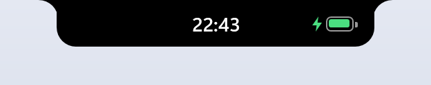

The closed notch has three slots: left, center and right. Each one shows a widget you pick: **Battery, To-Do, Clock, Date, Weather, Ping, FPS** or nothing at all.

- While music plays, the album art takes the left slot.
- While a focus timer runs, its countdown takes the right slot.
- With lyrics turned on, the closed notch shows only the album art and the line being sung.

### Six pages

Switch pages with the arrows on either side, or click the dots underneath.

| | |
|---|---|
| **Control Center** opens first when nothing is playing. It has Wi-Fi, Bluetooth, Hotspot, Power mode, Lock, Sleep, Restart, Shut down, Snip, and sliders for brightness and volume. Right-click a tile to open its Windows settings. |  |
| **Music** opens first while something plays. It works with any player that shows up in the Windows media controls (Spotify, YouTube in the browser, Apple Music and more). You get play/pause, skip, seek and **synced lyrics** from [LRCLIB](https://lrclib.net). See [Music and lyrics](#music-and-lyrics) below. | 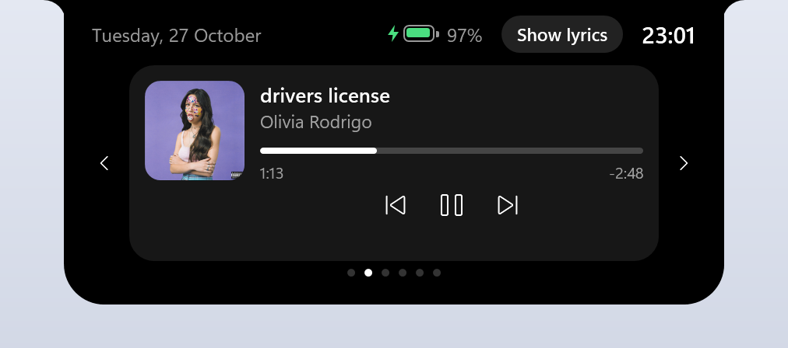 |
| **Focus** is a Pomodoro timer: 25 minutes of focus, 5 minutes of break, and a long break every four sessions. When time is up, the notch pops open with a chime. | 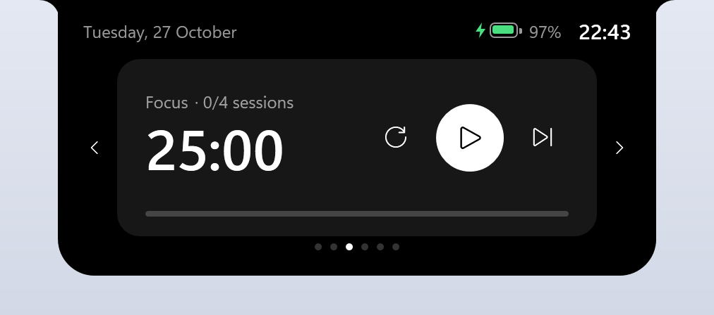 |
| **To-do**: type a task and press Enter, tick it when it's done, hover it to delete it. Finished tasks sink to the bottom. | 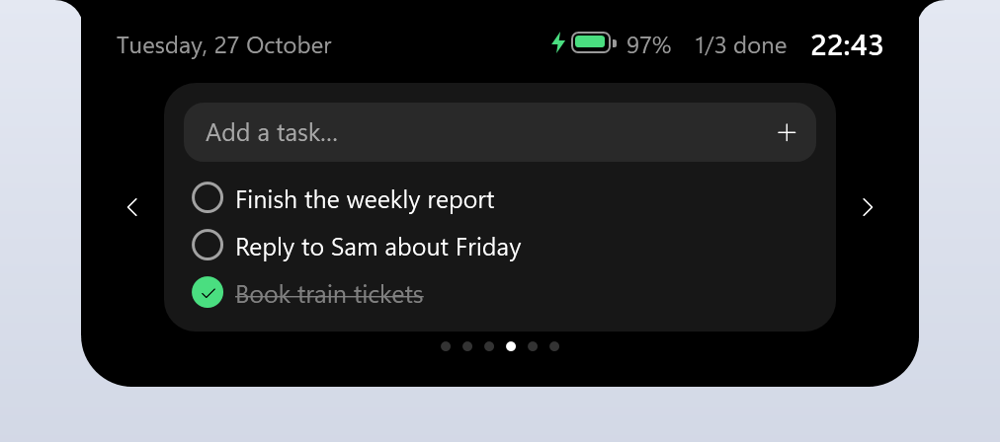 |
| **Quick note** is one scratch note that saves as you type. | 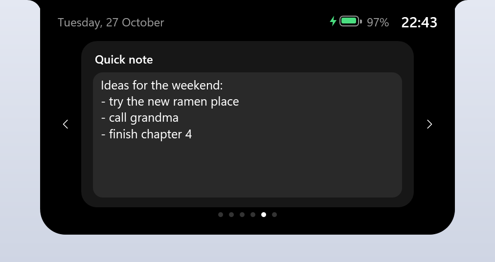 |
| **Settings** holds every option listed further down. | 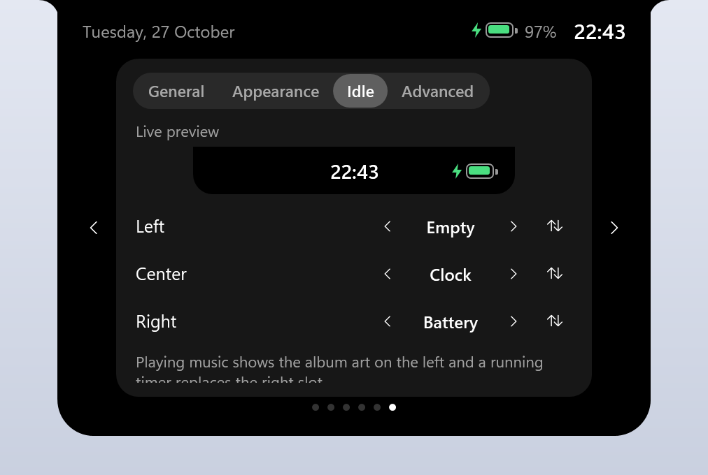 |

### Music and lyrics

Press **Show lyrics** on the Music page to turn lyrics on, and **Hide lyrics** to turn them off again.

| | Closed | Open |
|---|---|---|
| **Lyrics off**: the album art sits in the left slot next to the clock. | 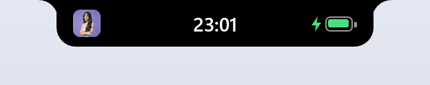 |  |
| **Lyrics on**: the closed notch shows only the album art and the line being sung, and grows to fit it. Open, the lyrics scroll along with the song; click a line to jump there. The notch takes on the colours of the album art. | 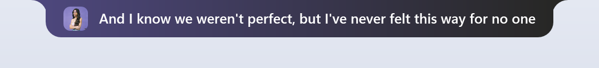 | 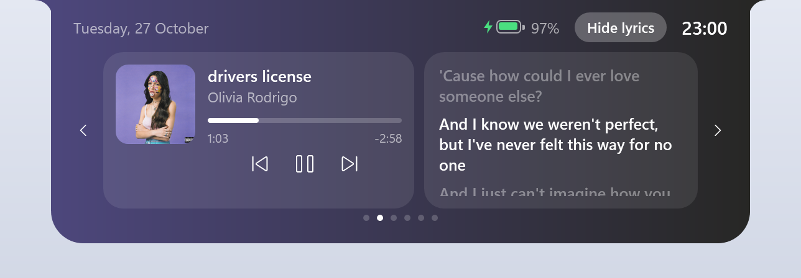 |

<sub>Album art and lyrics in these screenshots belong to their respective owners.</sub>

### Startup greeting

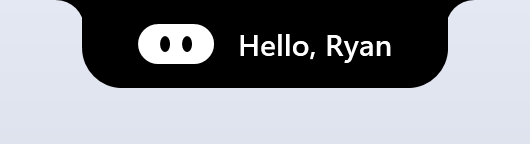

When Monday Notch starts, the logo pops in, blinks and says hello, using your Windows name or a name you choose.

### Anchored or floating

Pick the shape in **Settings > Appearance**.

| | Closed | Open |
|---|---|---|
| **Anchored** (default): attached to the top edge of the screen, with small inward curves where it meets it. |  |  |
| **Floating**: a rounded pill that hangs just below the top edge. You choose the gap, from 0 to 40 px. | 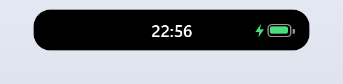 | 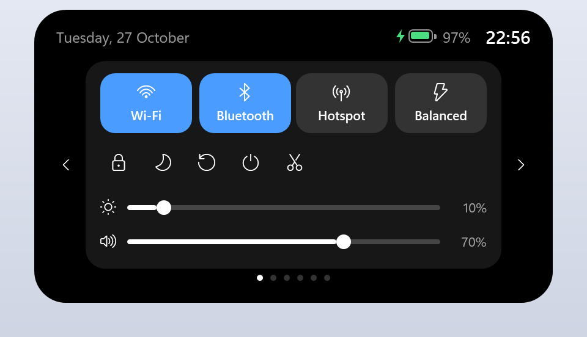 |

### Dark, light or auto

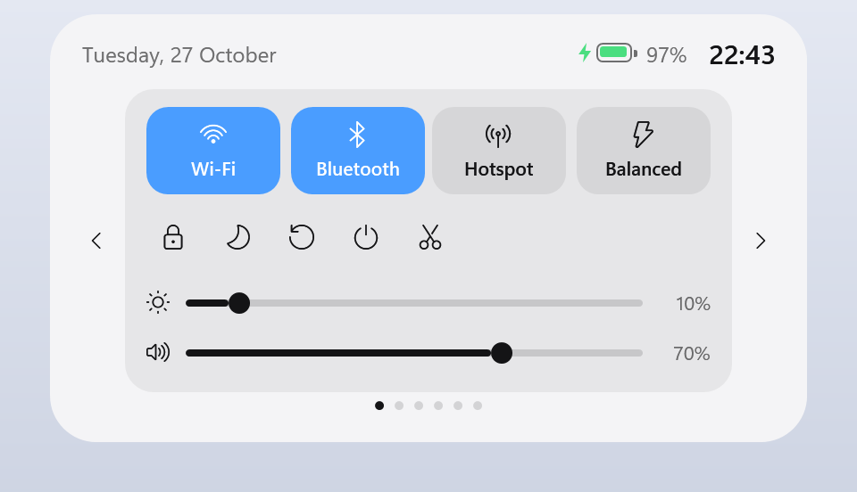

The light theme works with both shapes. **Auto** follows the app mode you've chosen in Windows.

## Settings

| Tab | Options |
|---|---|
| **General** | Start with Windows. Startup greeting, with the name set to Auto or Custom. Auto-compact, which shrinks the notch to a thin line while a browser is the active window. |
| **Appearance** | Notch shape: Anchored or Floating, with the distance from the top. Theme: Dark, Light or Auto. |
| **Idle** | A live preview of the closed notch, and the widget for the left, center and right slot, with buttons to swap them. |
| **Advanced** | Check for updates. Clean temporary files. Restart notch. Reset all settings. |

## Privacy

Monday Notch has no account and no analytics. Everything stays on your PC except the items below, and those only while you use them:

| Feature | What leaves your PC | Where it goes |
|---|---|---|
| Lyrics (when shown) | Song title, artist, album and length | [LRCLIB](https://lrclib.net) |
| Weather widget | Your location, rounded to about 1 km (Windows asks for permission first) | [Open-Meteo](https://open-meteo.com) |
| Ping widget | A ping every 5 seconds | 1.1.1.1 |
| Check for updates | A request for the latest release | GitHub |

Your data is stored in:

- Settings: `HKCU\Software\MondayNotch`
- To-dos: `%AppData%\MondayNotch\todos.json`
- Note: `%AppData%\MondayNotch\note.txt`

**Good to know**

- *FPS* is how many frames Windows draws per second for the whole screen. It shows how smoothly the screen is updating, not the frame rate of a particular game.
- *Clean temporary files* deletes files in `%TEMP%` that are more than a day old. Files in use are skipped, and you have to click twice to confirm.
- Brightness control works on built-in laptop screens. Most external monitors don't support it.

## Build from source

You need the [.NET 8 SDK](https://dotnet.microsoft.com/download) (or newer) on Windows 10 1809+ or Windows 11.

```bash
dotnet run
```

To build the same single `.exe` as the releases:

```bash
dotnet publish -c Release -r win-x64 --self-contained -p:PublishSingleFile=true -p:IncludeNativeLibrariesForSelfExtract=true -p:EnableCompressionInSingleFile=true -o publish
```

`MondayNotch.exe --snapshot out.png --no-media` renders every screen to `out-*.png` and exits. The screenshots in this README were made that way.

## Releasing a new version

Push a version tag. GitHub Actions ([release.yml](.github/workflows/release.yml)) then builds `MondayNotch.exe` and publishes it on the Releases page. The tag also becomes the version shown in the app.

```bash
git tag v0.2.0
```

```bash
git push origin v0.2.0
```

Each tag can be used only once, so every release needs a new number.

## Project layout

| Path | What's in it |
|---|---|
| `MainWindow.xaml(.cs)` | The notch: shape and animation, greeting, idle slots, the Music, Focus and To-do pages, page navigation |
| `Pages/` | The Control Center, Quick note and Settings pages |
| `App.xaml` | Shared styles and theme brushes |
| `IdleWidgetView.cs`, `BatteryIcon.cs` | Idle widgets and the battery drawing |
| `Services/` | Media, lyrics, album-art colours, system controls, volume, theme, settings, Pomodoro, to-dos, note, tray icon, maintenance |
| `assets/` | The logo (`logo.svg` and PNG sizes) and the app icon (`icon.ico`) |
| `docs/screenshots/` | The images used in this README |

## License

Monday Notch is released under the [MIT License](LICENSE).
